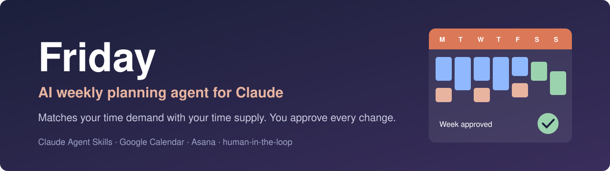
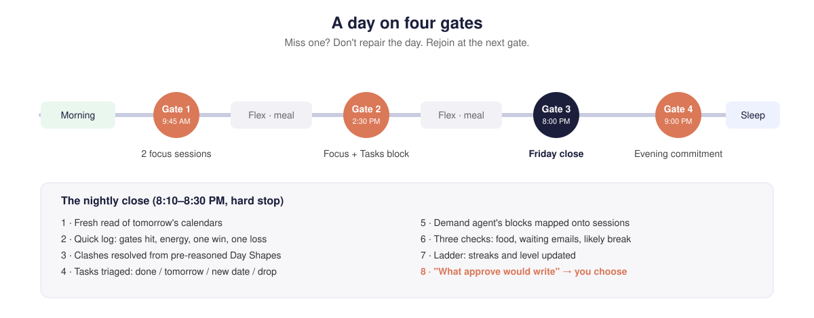
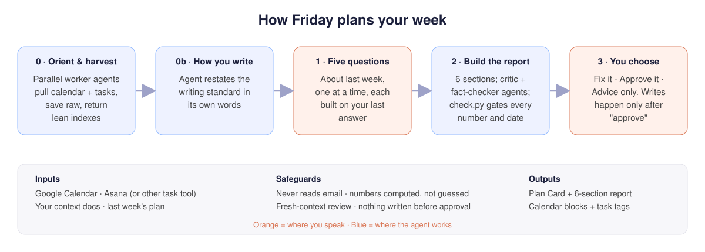
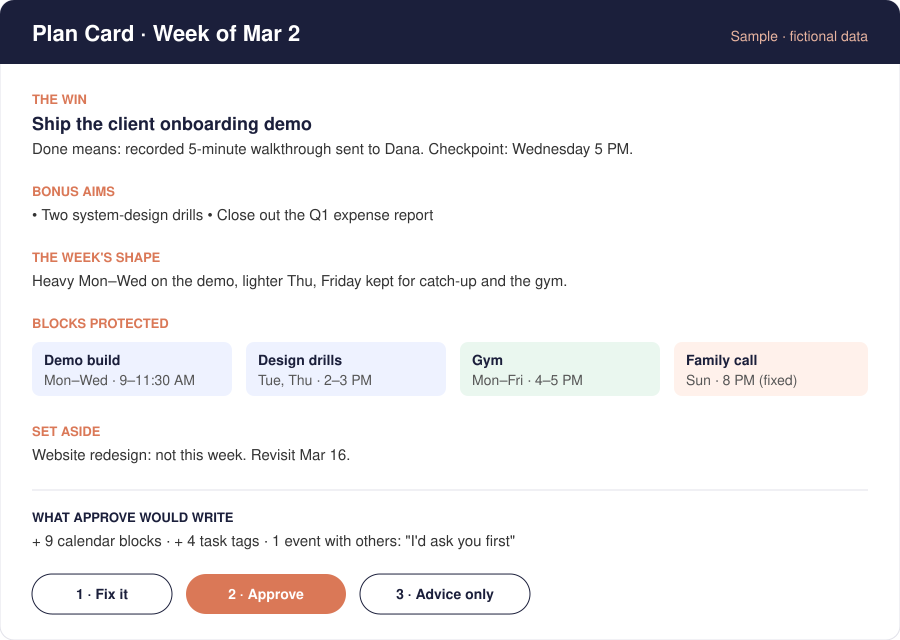
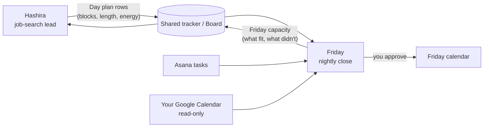

<p align="center"></p>

# Friday — AI Daily & Weekly Planning Agent for Claude (Agent Skills)

[](LICENSE)
[](https://docs.claude.com/en/docs/agents-and-tools/agent-skills/overview)
[](#getting-started)
[](#getting-started)
[](https://github.com/Sohanpatro/friday-planning-agent/stargazers)

> An open-source **AI planning assistant** that matches your **time demand** (tasks, goals, an upstream agent's study blocks) with your **time supply** (your calendar). A human-in-the-loop **productivity agent** built on Claude Agent Skills, working with Google Calendar, Google Sheets and Asana.

## Contents
- [Why](#why) · [How it works](#how-it-works) · [Usage examples](#usage-examples) · [Works with Hashira](#works-with-hashira) · [Repository layout](#repository-layout) · [Getting started](#getting-started) · [Roadmap](#roadmap) · [FAQ](#faq) · [Contributing](#contributing)

## Why

Most people's plans are fine. Their days just don't follow them. We keep appointments with other people and skip the ones with ourselves. A quick phone check turns into hours. A late night causes an afternoon crash.

Friday hangs each day on **four gates**, each one an appointment with someone else. Every night, at the close, it plans tomorrow **with** you: you see the clashes and the options, and you make every call. If you fall off during the day, you don't rebuild the day. You rejoin at the next gate.

## How it works

### Every day: four gates and a nightly close

<p align="center"></p>

| You say | Friday runs |
|---|---|
| `close`, `shutdown`, `plan tomorrow` | **Close**: the 20-minute nightly planning session (above) |
| `replan`, `I fell off`, `what now` | **Replan**: one minute; points you to the next gate |
| `where am I` | **Status**: level, streak, the gates left today |
| `weekly` | **Weekly**: direction for the next 14 days (below) |

### Every week: the weekly planning run

<p align="center"></p>

The weekly run uses the bundled `one-shot-weekly-planning` skill. Then Friday adds its own steps: it scores the week from your log, confirms your level, and writes next week's standard blocks to a dedicated Friday calendar.

### What you get

<p align="center"></p>

<sub>A sample weekly Plan Card, with made-up data.</sub>

### Design principles

- **You list, I decide.** Friday lays out demand, supply and clashes. It never picks a task, a date or a priority for you.
- **Nothing written without approval.** You always see "What approve would write" first, then choose: fix it, approve it, or keep it as advice only.
- **Fresh reads.** Every plan starts from a calendar read made in the same session, never from a summary.
- **A level system, not willpower.** A ladder of levels with streaks unlocks more focus sessions only after you've proven you can deliver the current level.
- **Pre-reasoned clash handling.** A *Day Shapes* table holds the options for each kind of conflict, so a small model can run the system reliably.
- **Writes to its own calendar.** Your main calendar is read-only. Friday writes only to the Friday calendar.
- **Stateless, with memory in your own storage.** The optional Board (a Google Sheet) holds your canon, log, rules and journal, for more precise results.

## Usage examples

| Say | What happens |
|---|---|
| `Friday, close` | 20-minute nightly session: tomorrow's demand vs. supply, the clashes and options; you decide, then approve the writes |
| `I fell off` | One-minute replan to the next gate, without rebuilding the day |
| `where am I` | Your level, streak and the gates left today |
| `plan my week` | The full weekly run: five questions on last week, a Plan Card, and next week's standard blocks |
| `move the gym to 4 PM` | Updates tomorrow's plan; nothing is written until you approve |

## Works with Hashira

Friday supplies the **time**. An upstream agent supplies the **demand**. [Hashira](https://github.com/Sohanpatro/hashira-the-complete-job-agent), the complete AI job search agent, writes daily study, interview-prep and search blocks, and Friday fits them into your real calendar.



## Repository layout

```
skills/
├── friday/SKILL.md                  # daily co-pilot: close, replan, status, weekly
└── one-shot-weekly-planning/        # the weekly planning run (Stage 1)
    ├── SKILL.md, prompts/, references/, scripts/check.py
templates/board/                     # optional Board: 12 CSV tabs with sample data
config/
└── friday.config.example.md         # your IDs, calendars, day template (copy → friday.config.md, gitignored)
assets/                              # README visuals
```

## Getting started

**Requirements:** Claude (claude.ai, the desktop app, or Claude Code) with Google Calendar, Google Sheets and Asana connected. Python 3 for `check.py`.

1. Clone the repo: `git clone https://github.com/Sohanpatro/friday-planning-agent.git`
2. Copy `config/friday.config.example.md` to `config/friday.config.md`. Fill in your calendars and your day template, and create a separate "Friday" Google calendar for Friday to write to.
   - *Optional, for more precise results:* set up the **Friday Board** from [`templates/board/`](templates/board/). It takes about 3 minutes, and the sample data is already in place.
3. Install both folders under `skills/`. In **Claude Code**, copy them to `~/.claude/skills/`. On **claude.ai**, zip each folder and upload it under Settings → Capabilities → Skills.
4. At 8 PM, say **"Friday, close"**.

## Roadmap

- [x] **Stage 1**: the weekly pre-planning skill
- [x] **Stage 2**: Friday, the daily co-pilot (gates, nightly close, replan, ladder, weekly run)
- [x] A Board template with sample data (optional)
- [ ] An integration guide for upstream demand agents (job prep, study plans)
- [ ] Routing-eval results

## Credits

The weekly run is inspired by the **Lifehack Method's Win the Week** ([lifehackmethod.com](https://lifehackmethod.com)).

## FAQ

**What is Friday?** An open-source AI planning agent, built as Claude Agent Skills, that plans your day and week with you from your Google Calendar and Asana tasks.

**Does it change my calendar?** Only a separate "Friday" calendar, and only after you approve. Your main calendar is read-only.

**Do I need Asana?** It works best with it. The weekly skill's connector notes cover other task tools.

**Will it decide my priorities?** No. Friday lists the demand, supply and clashes; you make every call.

**Which Claude plan do I need?** Any plan that supports Skills and the Google Calendar connector.

## Contributing

Issues and PRs are welcome. See [CONTRIBUTING.md](CONTRIBUTING.md). If Friday helps you win your week, **⭐ star the repo** so other people can find it.

## Author

Built by **Sohan Patro**, a software engineer building agentic AI systems. [LinkedIn](https://www.linkedin.com/in/sohanpatro/) · [GitHub](https://github.com/Sohanpatro)

## License

[MIT](LICENSE) for Friday and the repo's original material. See Credits for the weekly method's origin.
